<!-- Made by `bun run demo` from packages/server/demo/. Don't edit by hand. -->

# Screenshots

> [!NOTE]
> Everything shown here is mock data. Pixelnatt 2026, its schedule, Wi-Fi network and
> pictures are made up.

## Admin

### Live

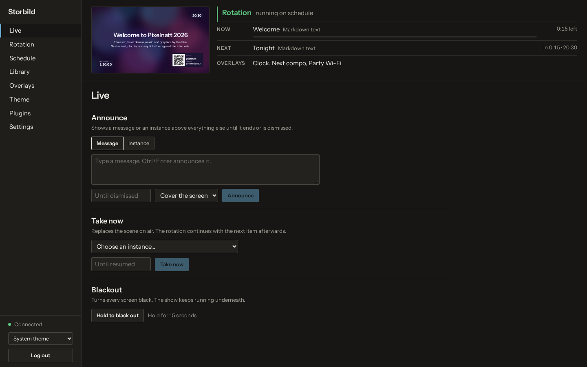

### Rotation

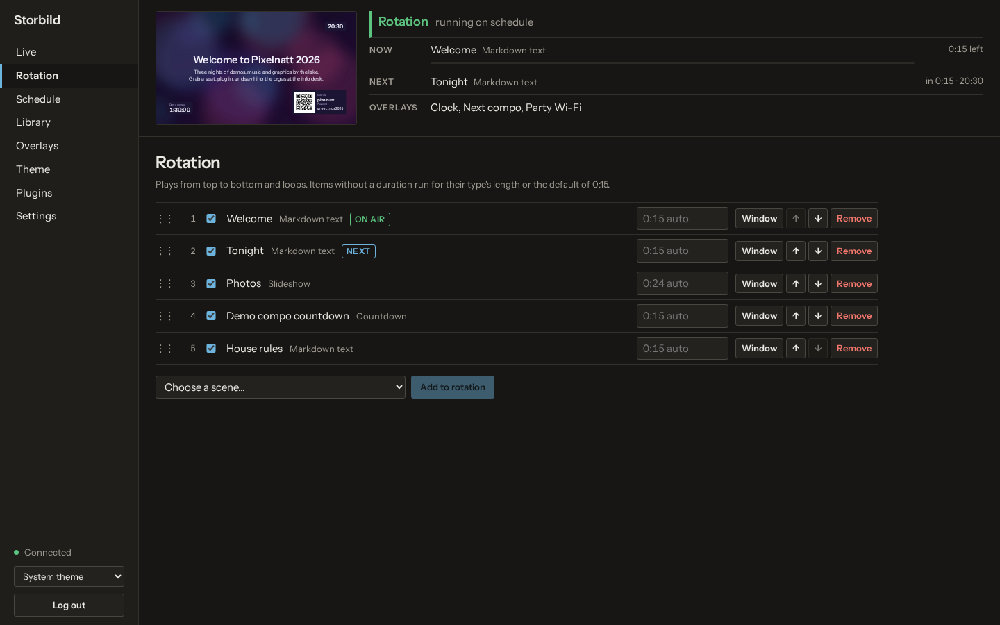

### Schedule

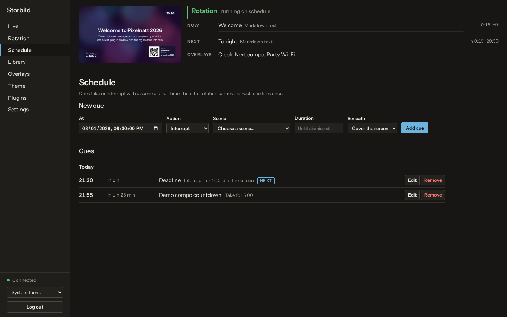

### Library

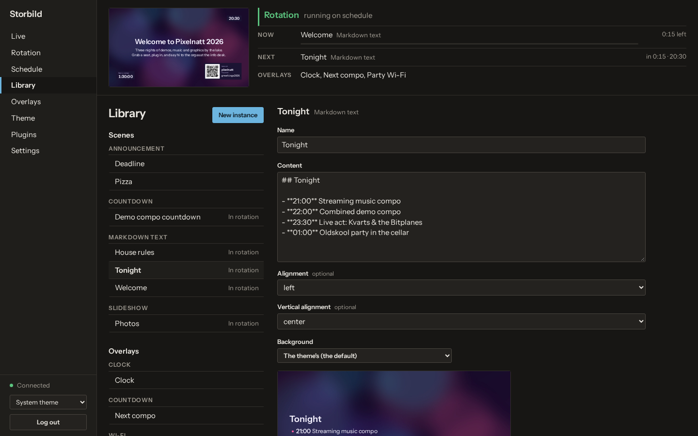

### Overlays

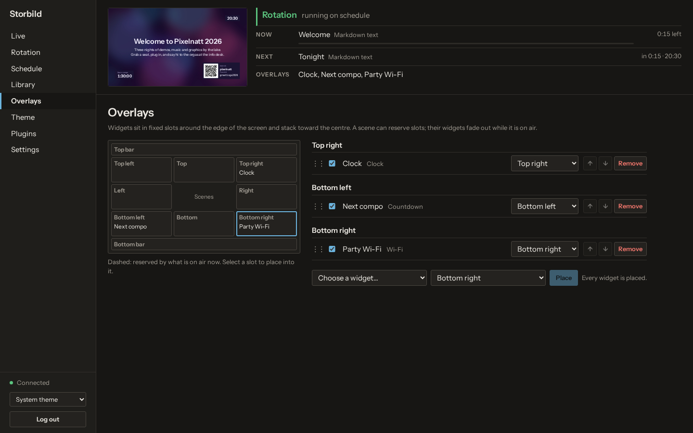

### Theme

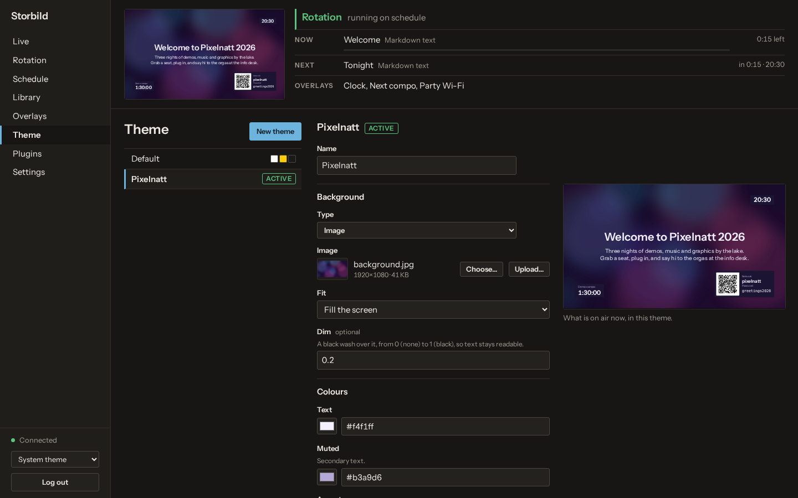

### Plugins

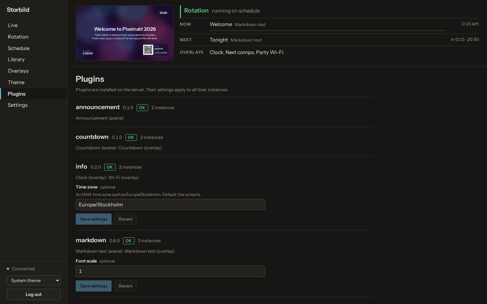

### Settings

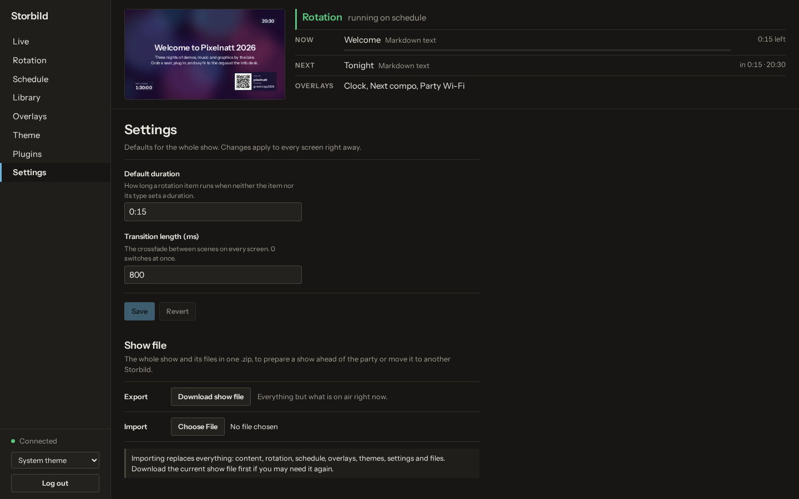

## Viewer

### Welcome text with the theme and overlays

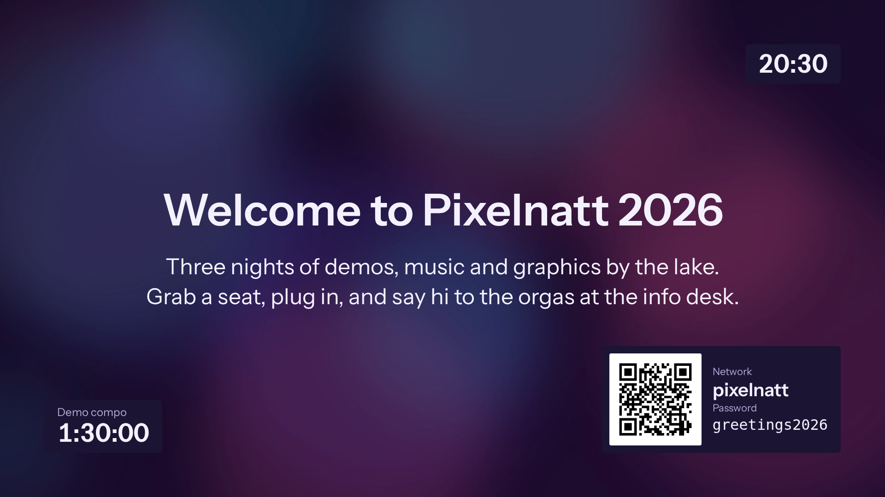

### Markdown text

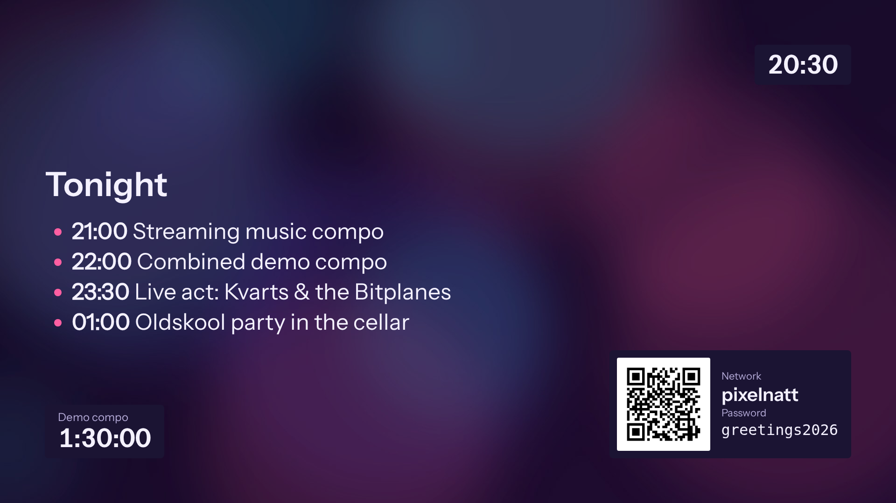

### Slideshow

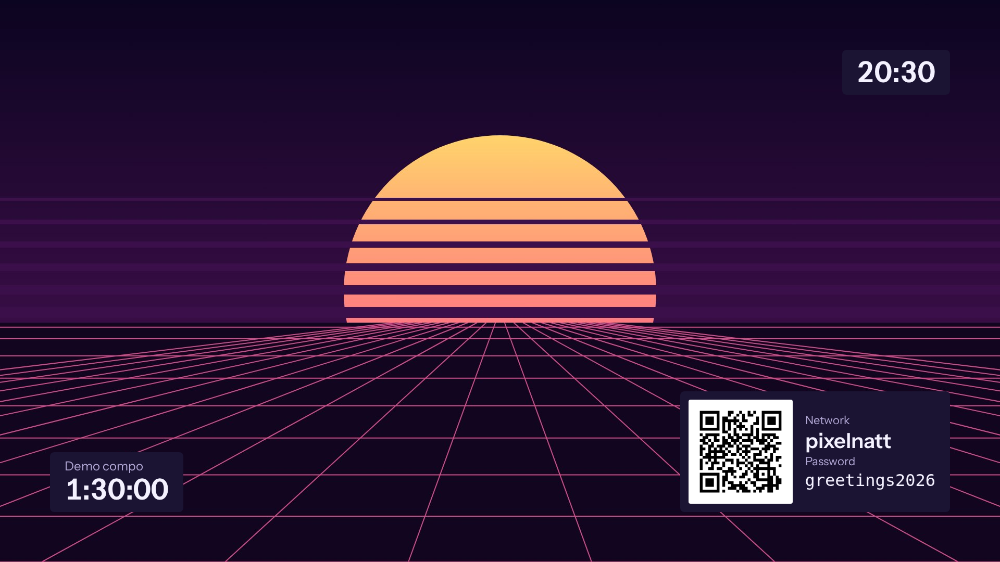

### Countdown

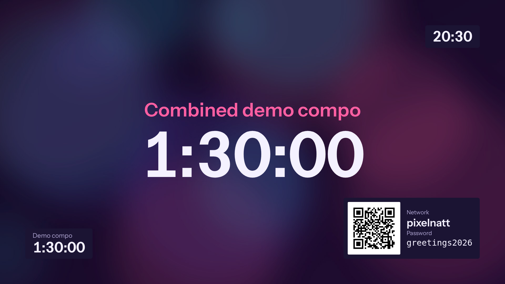

### Announcement over the dimmed screen

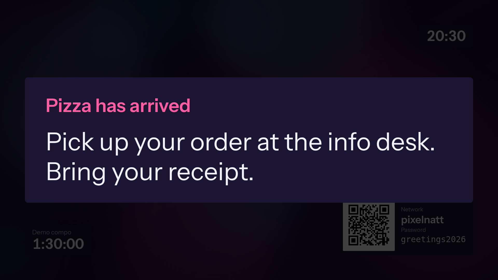
